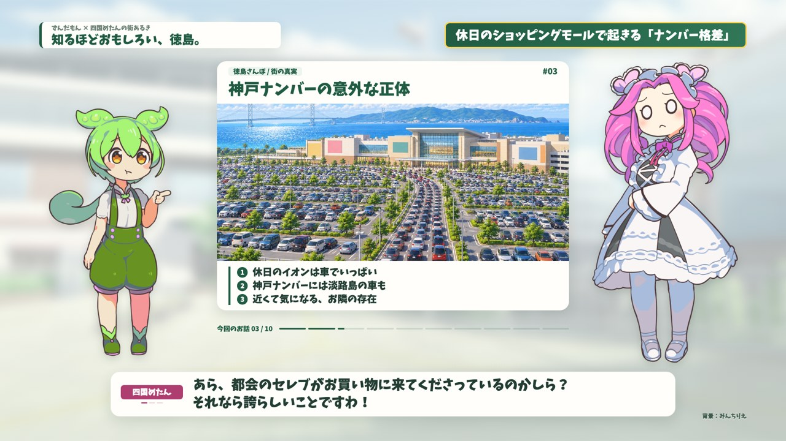

# ずんだもん × 四国めたん 動画制作キット

二人の掛け合い、中央の解説カード、読みやすい字幕を揃えた、1920×1080・30fpsのRemotionテンプレートです。既存の徳島編を収録しています。



## まず動かす

Node.js 18以上・Python 3.9以上を用意して、このフォルダで実行します。

```bash
npm install
npm run doctor
npm start
```

`npm start` でRemotion Studioが開きます。`DualExplainer` が二人の掛け合い版です。既存音声のままならVOICEVOXを起動せずに再生・書き出しできます。

## AIに頼むなら、この一文から

> 「○○」をテーマに、ずんだもんと四国めたんの掛け合い動画を作って。content/episode.json を編集して、1話題につき3〜5往復、見出しは短く、要点は3行に。既存のレイアウトを使い、全シーンの静止画を確認してから全編を書き出して。

## 編集するファイルは一つ

**`content/episode.json`** に番組設定・話題・セリフをまとめています。

| 変更したい内容 | 編集する項目 |
|---|---|
| 左上の番組名・締めのメッセージ | `program` |
| BGM音量・話速・セリフ後の間 | `audio` |
| 見出し・右上テロップ・要点・画像 | `topics` の `title` / `corner` / `points` / `image` |
| 二人の掛け合い | `topics[].lines` |
| 話すキャラクター | `speaker`: `zundamon` または `metan` |
| 表示する字幕・実際の読み方 | `text` / `voiceText` |
| 二人の表情 | `expressions.zundamon` / `expressions.metan` |

**`src/dual_scene_data.json` は自動生成です。直接編集しません。** 読み方を別指定したセリフは、内容を変えるときに `text` と `voiceText` の両方を直してください。表情の種類や台本の例は [制作ガイド](docs/AI_PROMPT_GUIDE.md) を参照してください。

## 確認して書き出す

字幕・画像・表情だけの変更なら、次の2コマンドです。

```bash
npm run preview
npm run render
```

- 静止画一覧: `out/review/index.html`（全セリフ＋エンディング）
- 完成動画: **`out/zundamon_metan.mp4`**（本編全体＋エンディング）

セリフを新しく作った場合は、[VOICEVOX](https://voicevox.hiroshiba.jp/)を起動してから実行します。

```bash
npm run audio:dual
npm run preview
npm run render
```

変更した音声だけを合成します。既存音声を変更せず字幕や絵を更新する `npm run sync` も使えます。未生成の音声がある場合は、古い音声を流さず、対象のセリフIDを表示して停止します。

AIに通しで制作を依頼する場合は `npm run video` で音声合成 → 検査 → 静止画出力 → 全編書き出しを連続実行できます。静止画の目視確認は別途必要です。

## 画面の仕組み

- 画面の座標は `src/layout.ts`、色と文字サイズは `src/theme.ts` に集約。
- 左にずんだもん、右に四国めたん。足元と字幕を分離。
- けいフォントが読み込めない場合は停止し、代替フォントのまま書き出さない。
- 中央カードは話題単位で表示。同じ話題の話者交代では入場演出を繰り返さない。
- 要点は1〜3行、見出し38px・要点24px・字幕33px。長すぎる見出しや要点はプレビュー時にエラーで知らせる。
- 字幕は最大2行で自動折り返し・ページ切り替え。ページの時間配分は文字数ベースなので、長文は短いセリフに分けると音声と合わせやすい。
- 音量から毎フレームの口パクを計算。無音では口を閉じる。まばたきは二人の周期をずらす。
- 最後に約6.7秒のお礼・クレジット・「おしまい」が自動で付く。

## 立ち絵を準備する場合

同梱済みのPNGはそのまま使えます。対応する坂本アヒル様のPSD（ずんだもん2.3、四国めたん2.1）から再抽出する場合だけ、ルートにPSDを置いて実行してください。

```bash
python3 -m pip install psd-tools Pillow
npm run characters
```

対応PSDの口パク・まばたき差分を生成します。別の作者や別キャラクターのPSDはレイヤー構成が異なるため、抽出スクリプトの対応が必要です。

## コマンド一覧

| コマンド | 用途 |
|---|---|
| `npm run doctor` | 環境・素材・VOICEVOX接続の確認 |
| `npm start` | Studioで再生・シーク |
| `npm run audio:dual` | 必要な音声を合成し、尺と口パクを更新 |
| `npm run sync` | 既存音声だけで台本・画像・表情を同期 |
| `npm run check` | 台本・素材・TypeScriptの検査 |
| `npm run preview` | 全セリフとエンディングの静止画一覧 |
| `npm run render` | 完全版MP4を書き出す |
| `npm run sample` | 全編を書き出し、紹介ページの動画・ポスター・チャプターを差し替え |
| `npm run video` | 音声から全編書き出しまで連続実行 |
| `npm run clean` | このツールの既知の中間プレビューを整理 |
| `npm test` | 音声キャッシュ・タイムライン・口パクの回帰検証 |

## クレジット

音声: **VOICEVOX:ずんだもん / VOICEVOX:四国めたん**
立ち絵素材: **坂本アヒル様**
フォント: **けいフォント（フォントな / MODI工場様）**
背景: **みんちりえ**
BGM: **しゃろう「2:23 AM」**

エンディングにも表示されます。素材を変更した場合はクレジットも合わせて更新してください。
